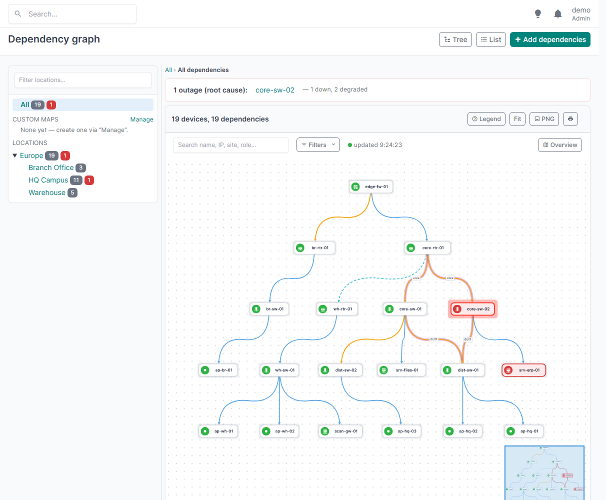
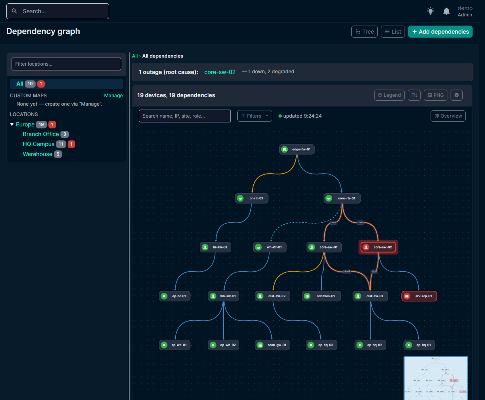
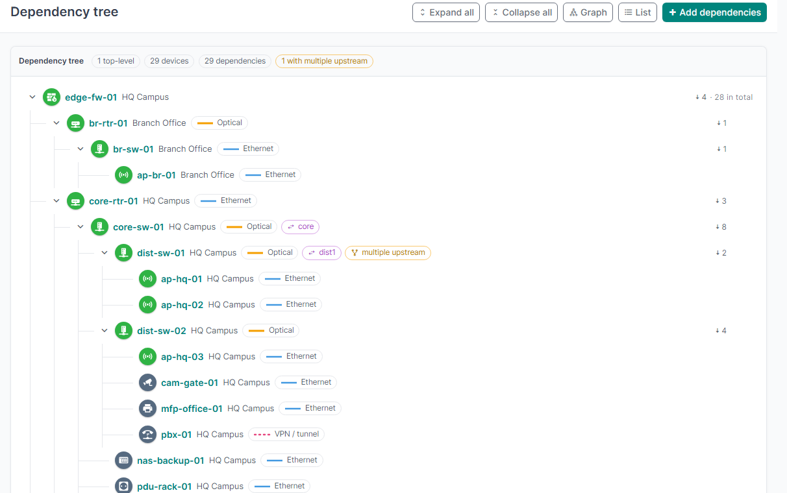
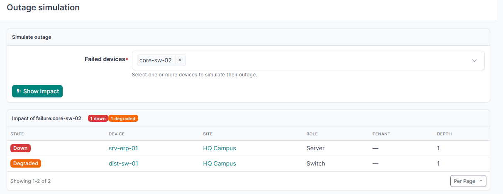
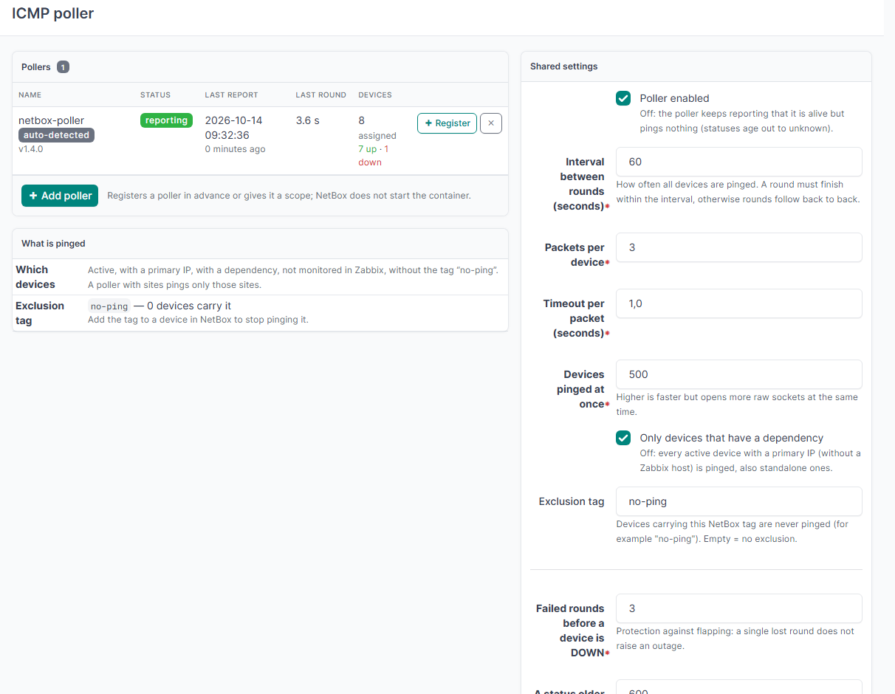
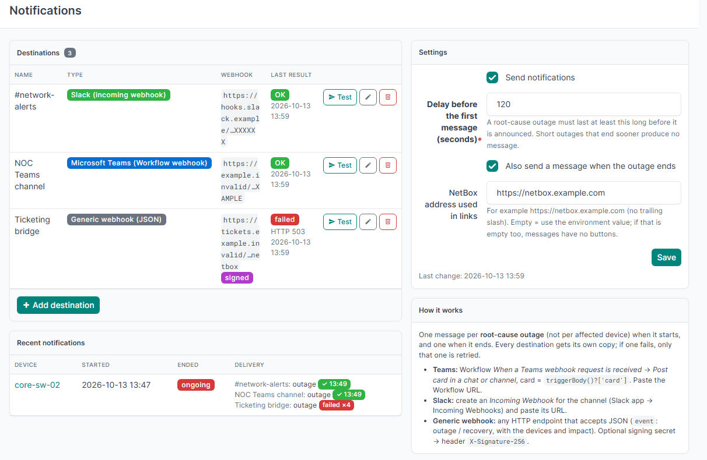

# NetBox Dependencies

A [NetBox](https://github.com/netbox-community/netbox) plugin that models **which device depends on which**
and answers the question *"if this device fails, what else goes down?"* — on a graph, in a tree, and
live, with optional notifications to Microsoft Teams, Slack or any webhook.



<details><summary>Dark theme</summary>



</details>

*Screenshots use fictional demo data.*

## Features

- **Dependencies** between devices: upstream → downstream, link medium (Ethernet, optical, radio, VPN / tunnel, LTE / 5G, satellite), optional
  **redundancy groups** (a device goes *down* only when all its redundant parents are down, otherwise it is *degraded*).
  Cycles, self-references and duplicates are rejected. REST API included.
- **Export and import as CSV:** *All dependencies → Export → Re-importable CSV* downloads the (filtered) list in exactly the columns the *Import*
  page reads (`upstream,downstream,dependency_type,medium,redundancy_group,description,tags`; devices by name). Edit it in a spreadsheet or
  import it into another NetBox. Import adds links and rejects duplicates; it does not update existing ones.
- **Interactive graph** (Cytoscape.js) per site, region or custom map; other locations appear as clouds that open
  their own map. Search, filters, role icons, PNG export, minimap. Click a link for its details (medium, type, redundancy group, description). Hover a device for its description and notes. *Filters → Link style* switches between curved and straight arrows (remembered per browser). Layouts are saved automatically; a region (or *All*) that has no layout of its own is composed from the layouts of its sub-locations, side by side.
- **Outage simulation**: right-click a device in the graph (or use the simulation page) to see everything it would take down.
- **Add dependencies from the graph:** click a device and use *Add dependents* (this device is the upstream one) or *Add parent* (this device depends on others);
  the add page opens with the device filled in and returns to the graph afterwards.
- **Live status** from two sources: the [Zabbix](#zabbix-optional) sync and a built-in **ICMP poller** for devices
  that are not monitored elsewhere.
- **Root-cause analysis**: a live outage is split into *root causes* and devices that are merely *explained* by an upstream failure.
- **Notifications** to any number of destinations (Teams, Slack, generic JSON webhook): one message per root-cause outage,
  one when it ends.
- Tree view, device tab "Dependencies", pagination and limits for large networks.





## Compatibility

Developed and tested with **NetBox v4.6.x** (`min_version = 4.6.0`), Python 3.12+.
Other NetBox versions are not tested.

## Installation

You need NetBox **4.6** (with PostgreSQL and Redis, as always) and a running NetBox **worker** (`rqworker`) — the worker runs the job
that refreshes the device status every minute. The plugin has no Python dependencies besides NetBox itself.

Pick the way you run NetBox: [with netbox-docker](#with-netbox-docker) or [a classic installation](#classic-installation-systemd-virtualenv).
Afterwards continue with [First steps](#first-steps).

### With netbox-docker

1. **Put the Dockerfile next to your `docker-compose.yml`.** Copy [examples/Dockerfile-Plugins](examples/Dockerfile-Plugins) into the
   netbox-docker folder. It installs the plugin from the release wheel (the NetBox image has no `git`). Open the file and set the version in
   both places of the URL to the one shown on the [Releases](https://github.com/Kinet-s-r-o/netbox-dependencies/releases/latest) page.
2. **Use that image** for the three NetBox services — add this to `docker-compose.override.yml`:

   ```yaml
   services:
     netbox:
       image: netbox-with-dependencies:latest
       build: {context: ., dockerfile: Dockerfile-Plugins}
       pull_policy: never
     netbox-worker:
       image: netbox-with-dependencies:latest
       pull_policy: never
     netbox-housekeeping:
       image: netbox-with-dependencies:latest
       pull_policy: never
   ```
3. **Enable the plugin** in `configuration/plugins.py` (keep the plugins you already have in the list):

   ```python
   PLUGINS = ['netbox_dependencies']

   PLUGINS_CONFIG = {
       'netbox_dependencies': {
           # everything here is optional — see "Configuration" below
           'public_url': 'https://netbox.example.com',     # the address of your NetBox, used for buttons in Teams / Slack messages
       },
   }
   ```
4. **Build and start:** `docker compose build && docker compose up -d`. The migrations run automatically when the container starts.

### Classic installation (systemd, virtualenv)

1. **Install the package** into the NetBox virtualenv. Use the wheel from the
   [latest release](https://github.com/Kinet-s-r-o/netbox-dependencies/releases/latest) — the version appears twice in the URL, use the one shown there:

   ```bash
   /opt/netbox/venv/bin/pip install https://github.com/Kinet-s-r-o/netbox-dependencies/releases/download/v1.14.0/netbox_dependencies-1.14.0-py3-none-any.whl
   ```

   To keep it across NetBox upgrades add the same URL as a line to `local_requirements.txt` in the NetBox directory.
2. **Enable it** in `configuration.py` — the same `PLUGINS` / `PLUGINS_CONFIG` as in step 3 above.
3. **Migrate and restart** NetBox *and* the worker:

   ```bash
   /opt/netbox/venv/bin/python /opt/netbox/netbox/manage.py migrate
   sudo systemctl restart netbox netbox-rq
   ```

### Check that it works

Log in: the menu **Dependencies** is in the sidebar. Superusers see everything; for other users grant object permissions on
*Dependencies → dependency / custom map / notification settings / poller settings* (view, and add / change / delete for editors).
If the menu is missing, see [Troubleshooting](#troubleshooting).

### First steps

1. **Add dependencies:** *Dependencies → Add dependencies* (pick the parent and several children at once), or import a CSV
   (*All dependencies → Import*; columns `upstream,downstream,dependency_type,medium,redundancy_group,description,tags`).
2. **Open the graph** (*Dependencies → Dependency graph*): maps per site and region; right-click a device to simulate its outage.
3. **Get a live status** — at least one of:
   - the [ICMP poller](#icmp-poller) (a small container that pings the devices) — works for any device with a primary IP;
   - the [Zabbix](#zabbix-optional) integration, if you use Zabbix and the `netbox_zabbix_status` plugin (nothing to configure).
4. **Notifications (optional):** *Dependencies → Configuration → Notifications* → add a Teams / Slack / webhook destination and press *Test*.

### Upgrading

Install the newer wheel (new version in the URL), run `migrate`, restart NetBox and the worker, and — if you run the poller — change the poller
poller to the same version (change the `#v…` and the tag in its `build:` / `image:` lines and run `docker compose up -d --build dependencies-poller`). Read the [changelog](CHANGELOG.md) first.

### Uninstalling

To remove the data too, run `manage.py migrate netbox_dependencies zero` **first**; then remove `netbox_dependencies` from `PLUGINS`, restart,
and `pip uninstall netbox-dependencies`. Without the first step the tables (`netbox_dependencies_*`) simply stay in the database.

## Configuration

All keys of `PLUGINS_CONFIG['netbox_dependencies']` are optional:

| Key | Default | Meaning |
|---|---|---|
| `fail_threshold` | `3` | default for "failed rounds before DOWN" (change it later on the ICMP poller page) |
| `status_stale_after` | `600` | default for "a status older than this is unknown" (also editable on the poller page) |
| `zabbix_stale_after` | `900` | the same for the Zabbix snapshot |
| `zabbix_down_patterns` | see `__init__.py` | regexes; a Zabbix problem whose name matches means "unavailable" |
| `zabbix_sync_interval` | `1` | minutes between status syncs |
| `graph_max_nodes` | `1500` | larger graphs are not drawn (pick a site / map instead); `0` = no limit |
| `notifications_enabled`, `notification_delay_seconds`, `notify_recovery`, `public_url` | `True`, `120`, `True`, `''` | initial defaults for notifications; they can be changed in the UI afterwards |
| `notification_retention_days` | `90` | delete notification records this many days after the outage ended; `0` = keep |

## ICMP poller

Devices that are not monitored in Zabbix can be pinged by a small separate container. At the start of every round it downloads the
list of targets **and its settings** from NetBox, pings the targets in parallel and reports raw results plus a heartbeat; the decision "DOWN"
(failure threshold) is made by the plugin.

Setting it up takes three steps and no Docker build. The poller needs its own NetBox user and API token — the plugin creates both for you:

1. **Create the user, the token and the environment file.** Run the command where NetBox runs. `--netbox-url` is the address of NetBox *as the
   poller container will see it* (with netbox-docker `http://netbox:8080`; otherwise your NetBox URL, for example `https://netbox.example.com`).

   With netbox-docker (run in the netbox-docker folder):

   ```bash
   docker compose exec netbox /opt/netbox/venv/bin/python /opt/netbox/netbox/manage.py dependencies_setup_poller \
       --name netbox-poller --netbox-url http://netbox:8080 --write /tmp/dependencies-poller.env
   docker compose cp netbox:/tmp/dependencies-poller.env ./dependencies-poller.env
   docker compose exec netbox rm /tmp/dependencies-poller.env
   ```

   Without Docker:

   ```bash
   /opt/netbox/venv/bin/python /opt/netbox/netbox/manage.py dependencies_setup_poller \
       --name netbox-poller --netbox-url https://netbox.example.com --write dependencies-poller.env
   ```

   The command creates a dedicated user `dependencies-poller` (no password, not a superuser) that may only read devices and report device
   status, makes an API token for it and writes `dependencies-poller.env` (file mode 600, never overwritten). The token is shown only once; keep
   the file private and out of git. Add `--allowed-ip 10.0.0.5/32` to accept the token only from the poller's address, or run the command with
   `--rotate` later to replace the token.
2. **Add the service** to your compose file (next to the file from step 1; for netbox-docker `docker-compose.override.yml`). Use the same version
   as the plugin (`#v1.14.0` below). Docker builds the small image straight from this repository, so no registry or account is needed:

   ```yaml
   services:
     dependencies-poller:
       build: https://github.com/Kinet-s-r-o/netbox-dependencies.git#v1.14.0:poller
       image: netbox-dependencies-poller:1.14.0
       restart: unless-stopped
       env_file: dependencies-poller.env
       cap_drop: [ALL]
       cap_add: [NET_RAW]            # raw ICMP sockets, nothing else
       read_only: true
       security_opt: ["no-new-privileges:true"]
   ```

   A prebuilt image is published with every release as `ghcr.io/kinet-s-r-o/netbox-dependencies-poller:<version>` — you can use
   `image: ghcr.io/kinet-s-r-o/netbox-dependencies-poller:1.14.0` instead of the two lines `build:` and `image:` (it works once the package is public).
   If `docker compose build` stops with `failed to execute bake`, run it with `COMPOSE_BAKE=false`.
3. **Start it:** `docker compose up -d --build dependencies-poller` (the first start builds the image, about a minute) and look at `docker compose logs -f dependencies-poller` — after a round it prints
   `polled N devices`. The poller then appears under *Dependencies → Configuration → ICMP poller*.

Container environment variables: `NETBOX_URL`, `NETBOX_TOKEN`, `POLLER_NAME` (shown in NetBox; default the container's host name) and
`VERIFY_SSL` (1). `POLL_INTERVAL` (60), `PING_COUNT` (3), `PING_TIMEOUT` (1) and `PING_CONCURRENCY` (500) are only fallbacks until NetBox answers.



Everything else is managed in **Dependencies → Configuration → ICMP poller**, and a change applies in the poller's next round (no restart):

- **Is it alive?** One row per poller: status, last report, how long the last round took, how many devices it was assigned and how many are
  up / down. A poller that reports but is not registered shows as *auto-detected*.
- **Add / edit pollers** (*Add poller*, the pencil, *Register*): a description, enabled or not, a **scope** (sites) and its own interval,
  packets, timeout and concurrency (empty = the shared value). The *name* must equal the container's `POLLER_NAME`.
  A poller with sites pings only the devices of those sites and every other poller skips them, so one poller per network never pings a
  device twice. Pollers without sites share everything that nobody claims. NetBox does not start the container — it only manages it.
- **Shared settings:** enabled / paused, interval, packets per device, timeout, devices pinged at once, only devices that have a dependency,
  failed rounds before DOWN, how long a status stays valid.
- **Exclusion tag:** devices carrying this NetBox tag (default `no-ping`) are never pinged.
- **Silent-poller alert:** if a poller has not reported for the configured time (default 5 minutes) a message goes to the notification
  destinations, and another one when it is back. Use *forget* for a poller that was removed on purpose; a poller switched off in NetBox
  does not alert.

### Sizing

A *round* is the time to ping every device once; it should finish well within the interval. The worst case (every device is down, so every
packet waits for its timeout) is `ceil(devices / at once) × (packets × timeout + (packets − 1) × 0.2 s)`; devices that answer are done in
milliseconds, so real rounds are usually much shorter. The ICMP poller page shows this estimate per poller, warns when it exceeds the interval
and offers recommended profiles (*Use* fills the form, nothing is saved until *Save*):

| Profile | For | Interval | Packets × timeout | At once | Down device noticed after |
|---|---|---|---|---|---|
| Small network | up to ~200 devices | 60 s | 3 × 1.0 s | 200 | ~3 min (3 failed rounds) |
| Medium network | 200 – 1000 | 60 s | 2 × 1.0 s | 500 | ~3 min |
| Large network | 1000 – 5000 | 120 s | 2 × 0.8 s | 1000 | ~6 min |
| Fast detection | up to ~500, reliable network | 30 s | 2 × 0.5 s | 500 | ~1 min (2 failed rounds) |
| Slow links (radio, VPN, satellite) | any | 120 s | 4 × 2.0 s | 200 | ~6 min |

If a round is slower than the interval, rounds follow each other without a pause and a status older than its validity turns to *unknown*.
Fixes, in order: raise *devices pinged at once* (the page suggests a value), lower packets or timeout, lengthen the interval (and the validity),
or split the network: register several pollers and give each its own sites.

## Zabbix (optional)

Zabbix is optional. If you already monitor devices in Zabbix, the separate NetBox plugin
[netbox-zabbix-status](https://github.com/Kinet-s-r-o/netbox-zabbix-status) (by the same author, read-only) brings the Zabbix hosts and their
problems into NetBox and links them to devices. When it is installed, this plugin uses it — there is nothing to configure here:

- a system job reads its host snapshot every minute: a device is DOWN when its enabled Zabbix host has an unsuppressed problem matching
  `zabbix_down_patterns` (for example "Unavailable by ICMP ping");
- devices with an enabled Zabbix host are skipped by the ICMP poller, so nothing is monitored twice;
- the job also repairs a stuck NetBox *Zabbix sync* job (left in `running` after a worker restart).

Without that plugin the Zabbix part is simply inactive and the ICMP poller provides the status of every device.

## Notifications

Everything is configured in **Dependencies → Configuration → Notifications**.



One message is sent per **root-cause outage** (not per affected device) once it has lasted the configured delay, and one when
the device is UP again (duration and peak impact). Several new root causes in one run are grouped into one message (10 are listed,
the rest is summarised). Every destination keeps its own delivery state: if one fails, only that one is retried (up to 10 times).
Each destination has a **Test** button that sends two clearly marked sample messages.

| Type | What to create | Payload |
|---|---|---|
| Microsoft Teams | Workflow *When a Teams webhook request is received* → *Post card in a chat or channel*, card = `triggerBody()?['card']` | `{"text", "card", "card_json"}` — Adaptive Card 1.4 |
| Slack | Slack app → *Incoming Webhooks* → add to a channel | `{"text", "attachments": [{"color", "blocks": [...]}]}` — Block Kit |
| Generic | any HTTP endpoint that accepts a JSON POST | see below |

**Generic webhook** body (`event` is `outage` or `recovery`; `test: true` for the sample messages):

```json
{"version": 1, "source": "netbox-dependencies", "event": "outage", "test": false,
 "sent_at": "2026-10-13T12:00:00+00:00", "text": "plain text summary",
 "outages": [{"device": {"id": 12, "name": "core-sw-02", "site": "HQ Campus", "url": "...", "graph_url": "..."},
              "started_at": "...", "duration_seconds": 1800, "source": "ICMP poller - no ICMP reply",
              "impact": {"down": 1, "degraded": 2, "affected": ["srv-erp-01", "dist-sw-01"]}}]}
```

`recovery` carries `recoveries: [{device, started_at, resolved_at, duration_seconds, peak_impact: {down, degraded}}]`.
If a **signing secret** is set, every request has the header `X-Signature-256: sha256=<hex HMAC-SHA256 of the raw body>` —
verify it before trusting a request.

Poller health messages use the same destinations: for the generic webhook `event` is `poller_down` or `poller_up` and the body carries
`poller: {name, last_seen, silent_seconds, url}`.

The command `manage.py dependencies_test_notifications [--destination NAME]` sends the sample messages from the command line.

## Troubleshooting

| Symptom | Likely cause | What to do |
|---|---|---|
| No **Dependencies** menu after installation | NetBox was not restarted, or the plugin is not in `PLUGINS` | Check `PLUGINS`, run `migrate`, restart **NetBox and the worker**; look for the plugin on the *Plugins* page of the NetBox menu |
| `ModuleNotFoundError: netbox_dependencies` on start | installed into the wrong Python environment | Install with `/opt/netbox/venv/bin/pip` (in Docker: into the image, see the Dockerfile example) |
| Page changed after an upgrade but still looks old | NetBox keeps templates in memory until a restart | Restart NetBox |
| The graph is empty | there are no dependencies yet | *Dependencies → Add dependencies*, or import a CSV |
| All devices are grey / "unknown" | nothing reports a status | Start the ICMP poller, or install `netbox-zabbix-status`; the device also needs a primary IP for the poller |
| A device is grey although the poller runs | no primary IP, it carries the `no-ping` tag, it is in a site claimed by another poller, or it has a Zabbix host | See *What is pinged* on the ICMP poller page |
| The poller log shows `HTTP Error 403` | wrong or expired token, or the token is restricted by `--allowed-ip` | Run `dependencies_setup_poller --rotate` and update the env file |
| The poller log shows `Connection refused` / `Name or service not known` | `NETBOX_URL` is wrong for the container | Use the address the *poller container* can reach NetBox on |
| The poller is "silent" on its page | it stopped or cannot reach NetBox | `docker compose logs dependencies-poller` |
| No Teams / Slack messages | notifications are off, no destination, or the outage is shorter than the delay | *Configuration → Notifications*: switch them on, press *Test*; default delay is 2 minutes. Only devices that have a dependency are announced |
| "Failed" next to a destination | the webhook rejected the message | The error is shown next to it; Teams needs the card from `triggerBody()?['card']` (see Notifications) |

## REST API

| Endpoint | |
|---|---|
| `/api/plugins/dependencies/dependencies/` | CRUD for dependencies |
| `/api/plugins/dependencies/maps/` | CRUD for custom maps |
| `/api/plugins/dependencies/impact/?device=<id>&device=<id>&limit=` | impact of failing devices |
| `/api/plugins/dependencies/outages/` | current root causes and explained outages |
| `/api/plugins/dependencies/status/targets/`, `.../status/report/`, `.../status/states/` | used by the poller and the graph |

## Impact rules

- No redundancy group: the failure of the upstream device takes the downstream device **down**.
- Several dependencies of one downstream device with the same `redundancy_group`: it goes down only when **all** of them are
  down; if only some are, it is **degraded** (and does not propagate further).
- Dependencies in different groups (or without a group) are independent and all mandatory.

## Security notes

- Webhook URLs and signing secrets are stored **in plaintext in the NetBox database** (many webhook URLs are bearer secrets themselves).
  They are never shown again in the UI (only a masked form), never written to the change log and never logged.
  Restrict database access accordingly and use dedicated webhooks that can be revoked.
- The poller token is limited to what the poller does (read devices, report status); `dependencies_setup_poller` creates exactly that. Do not use an administrator token.
- Reporting a vulnerability: please open a private security advisory on GitHub instead of a public issue.

## Development

```bash
# inside a NetBox container / virtualenv with PostgreSQL and Redis available
python manage.py test netbox_dependencies --keepdb
```

The pure graph algorithm has tests that need no database: `netbox_dependencies/tests/test_graph.py`.

## License

[MIT](LICENSE). Bundled third-party components are listed in [NOTICE](NOTICE).
